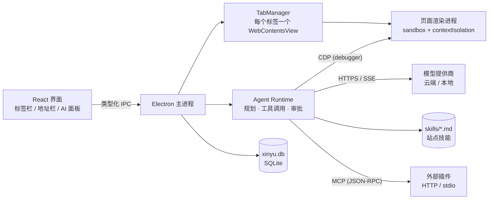

# Xinyu — 桌面 AI 浏览器

Xinyu 是一款把 AI Agent 作为核心能力的桌面浏览器。Agent 不是侧边栏里的问答机器人，而是能真正**看见页面、点击、输入、跨标签页操作**的执行体：每一步都通过 Chrome DevTools Protocol 完成，高风险动作先征求你的同意，验证有效的操作路径会按站点沉淀成技能。

基于 Electron 34 + `WebContentsView` + React 18 + TypeScript 构建，对应需求文档 v1.0 的 M1–M3 范围。

> 涉及**商品采集 / Shopify 导出**的开发，动手前先读 [`docs/COLLECT-SHOPIFY-RULES.md`](docs/COLLECT-SHOPIFY-RULES.md)：采集数据流、61 列模板与旧版 32 列方言的硬规则、变体与多图行布局、新增站点适配 SOP、导出验收清单都在那里。

---

## 快速开始

```bash
npm install
npm run dev          # Vite + Electron 热更新
# 或
npm run build && npm start
```

要求 Node 20+。首次启动会自动创建数据目录（Windows: `%APPDATA%/Xinyu`）。

> 如果在 CI 或远程桌面中运行，GPU 进程可能不可用，可设置 `XINYU_SOFTWARE=1` 强制软件渲染。

## 配置模型

打开「设置 → 模型」，选择预设或新增一个 OpenAI 兼容端点，填入 API Key 后点击模型名启用。无需重启。

| 类型 | 说明 |
| --- | --- |
| OpenAI / DeepSeek / Gemini / OpenRouter | 任意 OpenAI 兼容的 `/chat/completions` 端点 |
| Anthropic | 原生 Messages API（流式 + tool_use） |
| Ollama / LM Studio | 本地端点，通常无需 Key（`http://127.0.0.1:11434/v1`） |

API Key 通过系统安全存储加密（Windows DPAPI / macOS Keychain / Linux Secret Service），只写入 `secrets.json` 的密文，不会进入设置文件或日志。

## Google 账号登录

「设置 → 账号」或点击工具栏最右侧的头像按钮即可登录 Google 账号。授权使用桌面应用标准的 **环回地址 + PKCE** 流程（[RFC 8252](https://datatracker.ietf.org/doc/html/rfc8252)）：主进程在 `127.0.0.1` 随机端口监听回调，系统浏览器打开 Google 授权页，`state` 防伪造、授权码换令牌全程不经过嵌入网页，因此**只需要 Client ID，无需 Client Secret**。

登录后刷新令牌经系统加密存储（与 API Key 同一机制），头像与邮箱显示在工具栏菜单；退出登录时会同时撤销 Google 侧的授权。应用启动时会静默校验已存储的会话——只有确认被撤销（`invalid_grant`）才清除，网络不通时保留登录状态。

配置 Client ID 有两种方式：

- 「设置 → 账号 → OAuth Client ID」直接填写；
- 环境变量 `XINYU_GOOGLE_CLIENT_ID`（首次启动写入设置，之后以设置页为准）。

在 [Google Cloud 控制台](https://console.cloud.google.com/apis/credentials)创建 OAuth 客户端 ID，应用类型选「桌面应用」即可（环回地址与动态端口由 Google 自动允许，无需手动登记重定向 URI）。应用未发布时，记得在「OAuth 同意屏幕 → 测试用户」里加入你的账号，否则授权会报 `access_denied`。设置页内附完整步骤说明。

## 广告拦截

默认开启，工具栏的盾牌按钮显示当前窗口已拦截的数量，点开可一键关闭、关掉跟踪器拦截，或**在当前站点暂停**（暂停后自动刷新页面）。

拦截分三层，规则全部内置，不联网下载列表、不上传访问记录：

| 层 | 做法 |
| --- | --- |
| 广告请求 | 在网络层直接取消（`session.webRequest`），请求不会发出 |
| 跟踪器 | Google Analytics、广告像素、会话录制等独立开关，可只拦广告服务器 |
| IP 地址资源 | 网页里指向**公网** IP 的脚本、图片、iframe（广告与统计常用）；本机与局域网地址永不拦截 |
| 残留广告位 | 页面加载后用样式隐藏常见广告容器，避免留下空白块 |

IP 规则的边界写死在代码里：`127.0.0.0/8`、`10/8`、`172.16/12`、`192.168/16`、`169.254/16`、`100.64/10`（CGNAT）、`::1`、`fe80::/10`、`fc00::/7` 以及 IPv4-mapped 形式一律放行；文档层级的导航也永远不拦——直接输入 IP 打开的网站，自己的资源照常加载。

### 按住拦截任意元素

内置规则覆盖不到的广告位，可以自己在页面上点掉：工具栏盾牌 →「拦截页面元素」（或 `Ctrl/Cmd + K` 里搜「按住元素拦截」），进入拾取模式后鼠标移到哪就框出哪，**按住约半秒**即可隐藏该元素并记住规则；松手太早、按 `Esc` 或右键都算取消，普通点击不受影响。

选择器由拾取器自动生成并保证唯一：优先用 `#id`，其次 `标签.类名`，只有确实重复时才补 `:nth-of-type()`；像 CSS Modules 的哈希类名、`item-123456` 这类每次构建都会变的标识会被跳过。规则按域名保存（`settings.json` 的 `adblock.elementRules`），下次打开同一站点自动生效，可以在「设置 → 广告拦截 → 页面元素拦截」里逐条删除或清空。

「设置 → 广告拦截」里可以维护站点例外（填域名即覆盖全部子域）和自定义规则，每行一条，支持 `ads.example.com`、`example.com/sponsor/*`、`||tracker.example.com^` 三种写法，`#` 开头为注释。规则按后缀匹配域名，因此不会误伤 `notexample.com`；文档层级的导航永远不会被拦截。

## 扩展程序

工具栏的拼图按钮打开「扩展程序」面板，交互和 Chrome 的「加载已解压的扩展程序」一致：选一个含 `manifest.json` 的文件夹即可加载，之后可以单独启用/停用、重新加载（改完代码不用重启）、打开文件夹或移除。列表保存在 `settings.json` 的 `extensions` 里，扩展本体始终留在你自己的文件夹中——移除只把它从列表里拿掉，不删文件。

「新建自定义扩展」会生成一份可直接运行的 Manifest V3 模板（`manifest.json` / `content.js` / `background.js` / `README.md`）到数据目录的 `extensions/` 下并自动加载，改完点「重新加载」再刷新页面就能看到效果，不需要打包或上架。

| 能力 | 状态 |
| --- | --- |
| 内容脚本（`content_scripts`）、后台 service worker | 可用，按 `matches` 注入 |
| `chrome.storage` / `runtime` / `tabs` 等常用 API | 大部分可用（Electron 实现范围内） |
| 工具栏图标、`chrome.action` 弹窗、`chrome://` 内置页 | 不提供，面板里会标注「含弹窗（不支持）」 |
| 无痕窗口 | 默认不加载扩展 |

扩展加载在页面的 Session 上（`session.loadExtension`），因此对所有普通窗口的标签页生效；停用或新装后需要刷新页面，内容脚本才会重新注入。

## 使用 Agent

点击工具栏右侧的 **AI** 按钮（或 `Ctrl/Cmd + Shift + A`）打开面板，直接描述任务：

- 「在这个网站搜索蓝牙耳机，按销量排序，把前三名整理成表格」
- 「帮我填写当前页面的表单，先告诉我需要哪些信息」
- 「对比这三个标签页里同一商品的价格」

面板会实时展示每一步：打开了哪个地址、读取到什么结构、点击了哪个元素、耗时多久。高风险动作（提交表单、支付、删除、发送消息）会弹出确认卡片，展示动作内容、目标元素与涉及的数据，可选择「允许本次」或「始终允许此站点」。

Agent 完成任务后可以把操作路径保存为技能（Markdown），下次访问同一域名自动加载。技能可在「设置 → 技能」查看、编辑、删除，并可控制是否注入、是否允许自动保存、每次注入条数与单条字符上限。

插件是外部 MCP 服务提供的工具：在「设置 → 插件」里添加 HTTP 端点或本地命令，连接成功后这些工具会直接进入 Agent 的工具列表（名字以 `plugin__` 开头），调用前需要你确认。

### Token 消耗

每次任务结束后，回答下方会显示这次任务消耗的 token（悬停可看输入/输出明细），输入框下方同时显示本次对话的累计值。数字来自模型返回的用量：OpenAI 兼容端点用 `stream_options.include_usage`（服务端不认识该字段时自动去掉并重试一次，不会因此失败），Anthropic 读 `message_start` / `message_delta` 的 usage；模型完全没返回用量时按字符数估算，并标注「估算」。

### 审批级别

| 级别 | 行为 |
| --- | --- |
| 严格 | 每次点击、输入、导航都确认 |
| 标准（默认） | 提交表单、发送、支付、删除、敏感字段输入时确认 |
| 宽松 | 仅支付与删除等不可逆动作确认 |

## 架构



```
src/
  main/
    main.ts            应用生命周期、窗口注册、会话恢复、冒烟测试
    window.ts          BrowserWindow + 布局 + 快捷键 + 浮层管理
    tabs.ts            标签页 / WebContentsView / 崩溃隔离 / 右键菜单
    downloads.ts       下载跟踪、暂停恢复、危险文件拦截
    adblock.ts         广告/跟踪器拦截（按 session 挂载，计数器与样式注入）
    adblock-rules.ts   内置规则：广告域、跟踪器域、路径规则、隐藏样式
    adblock-helpers.ts 规则解析与匹配（纯函数，含单测）
    adblock-picker.ts  页面元素拾取器（按住拦截，注入脚本 + 选择器生成）
    extensions.ts      Chrome 风格扩展加载（loadExtension / 启停 / 重载 / 自定义模板）
    extension-helpers.ts manifest 解析、权限拆分、i18n 名称（纯函数，含单测）
    partitions.ts      Session 分区名常量（普通 / 无痕）
    db.ts              SQLite（sql.js）历史、书签、下载、日志、密码库
    settings.ts        设置与 safeStorage 密钥
    google-auth.ts     Google 账号 OAuth（环回 + PKCE）
    ipc.ts             全部 IPC handler（按 ApiMap 强类型约束）
    url.ts             地址解析、协议白名单
    mcp.ts             本地 MCP 端点（默认关闭）
    plugins.ts         MCP 插件客户端（HTTP / stdio，工具桥接到 Agent）
    agent/
      loop.ts          Agent 会话、工具循环、系统提示、上下文裁剪
      tools.ts         13 个浏览器工具 + 动态注入的插件工具
      cdp.ts           CDP 驱动：截图、点击、输入、axtree、网络空闲
      page-scripts.ts  注入页面的感知/操作脚本（SOM、弹窗、登录填充）
      providers.ts     OpenAI 兼容 + Anthropic 流式适配
      approvals.ts     风险分类与审批策略
      skills.ts        站点技能存取
      redact.ts        日志脱敏
  preload/             contextBridge（仅暴露 invoke/on）
  renderer/            React 界面
  shared/              主进程与渲染层共享的类型、IPC 契约、常量
```

### 三个关键实现决策

**1. 标签页 = 一个 `WebContentsView`**
页面视图是原生图层，浮在 React 界面之上。因此所有 chrome（标签栏、地址栏）和右侧面板都在视图边界之外；地址栏补全、命令面板这类必须覆盖页面的浮层，会把视图隐藏并在原位绘制一张页面快照作为背景，关闭后恢复——这就是需求文档里「原生视图遮挡 UI 浮层」风险的落地解法。

**2. Agent 与页面之间只走 CDP**
页面视图开启 `sandbox`、`contextIsolation`，不注入 preload，页面拿不到任何 Node 能力。Agent 通过 `webContents.debugger` 调用 `Input.dispatchMouseEvent`、`Runtime.evaluate`、`Accessibility.getFullAXTree`、`Page.captureScreenshot`，点击坐标天然穿透 iframe 与 Shadow DOM。

**3. 审批在工具执行前拦截**
每个工具先把目标元素描述出来，`approvals.ts` 依据按钮类型、文案、是否在表单内、是否密码字段做风险分类，再结合审批级别与站点白名单决定是否弹窗。敏感输入在卡片与日志里只显示掩码，密码字段的值不会进入模型上下文。

## 安全边界

- 页面渲染进程：`sandbox: true`、`contextIsolation: true`、`nodeIntegration: false`、禁用 `webview`、禁止 `window.open` 新建原生窗口。
- Agent 只允许 `http/https`，`file:`、`javascript:`、`data:`、`chrome:` 一律拒绝。
- 可执行文件下载默认拦截并询问；`will-download` 阶段暂停，用户确认后才重新发起。
- API Key 加密存储；操作日志与步骤摘要统一脱敏（sk-*、Bearer、卡号、password 字段）。
- 无痕窗口使用独立内存分区，关闭后清除该分区站点数据，不写历史、下载记录与技能。
- MCP 端点默认关闭，开启后只监听 `127.0.0.1`，每次启动生成随机 Bearer Token。

## 数据位置

| 内容 | 位置 |
| --- | --- |
| 设置 | `userData/settings.json` |
| 密钥密文 | `userData/secrets.json` |
| 历史 / 书签 / 下载 / 日志 / 密码库 | `userData/xinyu.db`（标准 SQLite 文件） |
| 站点技能 | `userData/skills/<domain>.md` |
| 自定义扩展（「新建自定义扩展」生成的模板） | `userData/extensions/<name>/`；外部扩展留在你选择的文件夹 |
| 会话恢复 | `userData/session.json` |

> SQLite 使用 `sql.js`（WASM）而非原生模块，避免 Electron ABI 重编译；生成的是标准 SQLite 文件，可随时用其他工具打开。

## 打包 Windows 安装包

```bash
npm run package       # 构建 + electron-builder
```

产物在 `dist-package/`：

| 文件 | 说明 |
| --- | --- |
| `Xinyu Setup 0.1.0.exe` | NSIS 安装器，可选安装目录，创建桌面与开始菜单快捷方式 |
| `Xinyu 0.1.0.exe` | 便携版，双击直接运行，不写注册表 |
| `win-unpacked/Xinyu.exe` | 免安装目录版 |

说明：

- 未配置代码签名证书，首次运行会触发 SmartScreen，需要「更多信息 → 仍要运行」。正式分发前应配置证书（CI 中的 `CSC_LINK` / `CSC_KEY_PASSWORD`）。
- 应用图标与版本信息由 `scripts/after-pack.js` 在打包后用 rcedit 写入。electron-builder 自带的 winCodeSign 归档在无符号链接权限的 Windows 上解压失败，因此关闭了 `win.signAndEditExecutable`，改在 `afterPack` 阶段处理。
- 图标由 `node scripts/make-icon.js` 生成（纯 Node 绘制并编码 PNG/ICO，无第三方依赖）。
- 默认只打包 x64；ARM64 可执行 `npx electron-builder --win --arm64`。
- 便携版与 `win-unpacked/Xinyu.exe` 已实测启动并跑通 `XINYU_SMOKE` 界面巡检；NSIS 安装器已生成但未在本机执行安装流程。

## 测试

```bash
npm test             # 单元测试：URL 解析、审批分类、脱敏、广告规则匹配等
```

端到端冒烟（会真实启动窗口并截图到 `smoke/`）：

```bash
# 界面巡检：新标签页、设置、地址栏补全、查找条、AI 面板、书签面板、命令面板
XINYU_SMOKE=1 npx electron .

# 广告拦截：本地页面混排首方图片与广告请求，验证拦截、暂停站点、隐藏广告位
XINYU_USER_DATA=/tmp/xinyu-adblock XINYU_ADBLOCK_SMOKE=1 npx electron .

# 扩展程序：临时扩展真实注入内容脚本，验证启停、移除与自定义模板
XINYU_USER_DATA=/tmp/xinyu-ext XINYU_EXT_SMOKE=1 npx electron .

# Agent 全链路：本地脚本化模型 → 导航 → 读取 → 点击（触发审批）→ 保存技能 → 完成
node scripts/mock-model.js &
XINYU_AGENT_SMOKE=1 npx electron .
```

广告拦截冒烟会改写设置文件，因此用 `XINYU_USER_DATA` 指向临时目录，避免动到真实配置。

`scripts/mock-model.js` 是一个仅用于测试的 OpenAI 兼容端点，同时提供一个带提交按钮的测试页面。

## 首版边界

以下需求为 P2，首版未实现，接口与数据结构已为其预留：

- 标签页分组（BR-05）、阅读模式（BR-18）、页面翻译（BR-19）
- 工作流录制与回放（AG-21 / AG-22）、按任务类型分配模型（AG-26）
- 快捷键自定义（ST-06，目前提供只读列表）
- 自动更新与签名验证（NF-09）
- 三平台安装包已配置 electron-builder，但只在 Windows 上完成实测；macOS / Linux 未验证
- 性能指标（NF-01…NF-05）未在低端机上做基准测试

逐条需求对照见 [docs/REQUIREMENTS-TRACEABILITY.md](docs/REQUIREMENTS-TRACEABILITY.md)。
# AIxinyu
